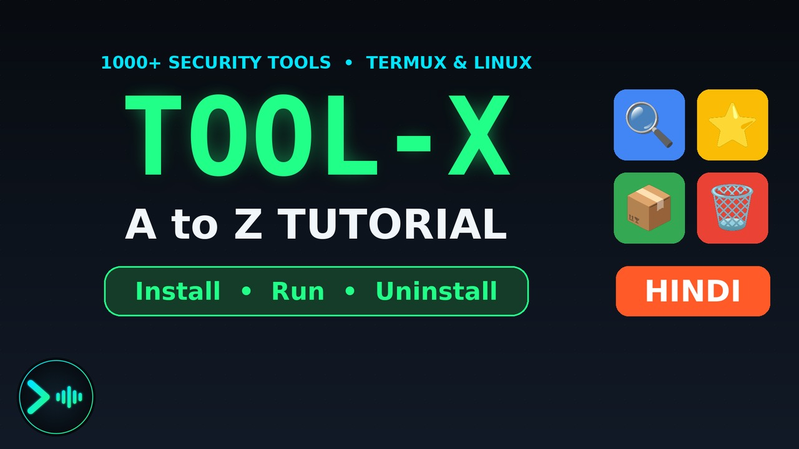
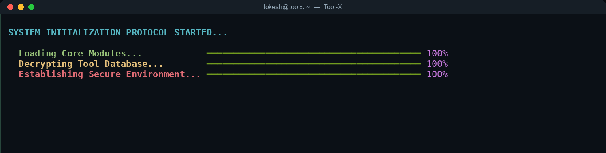
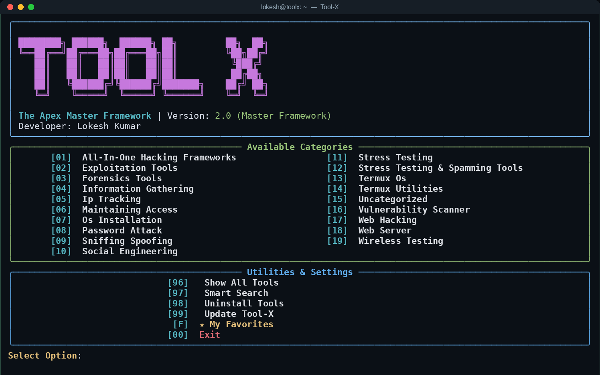
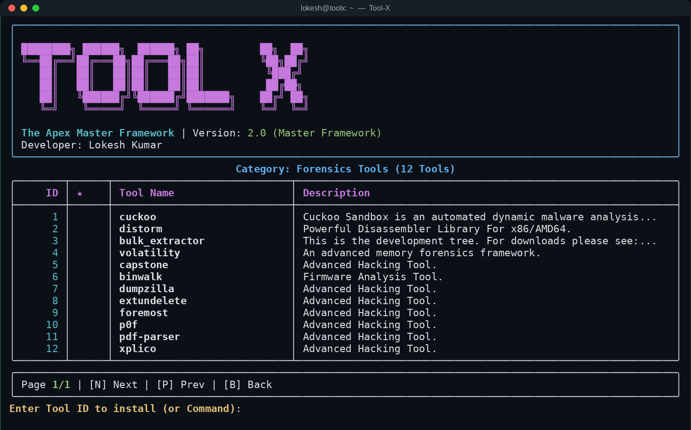
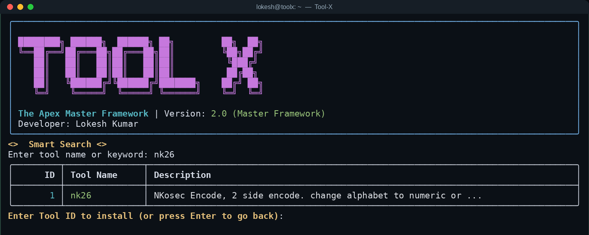
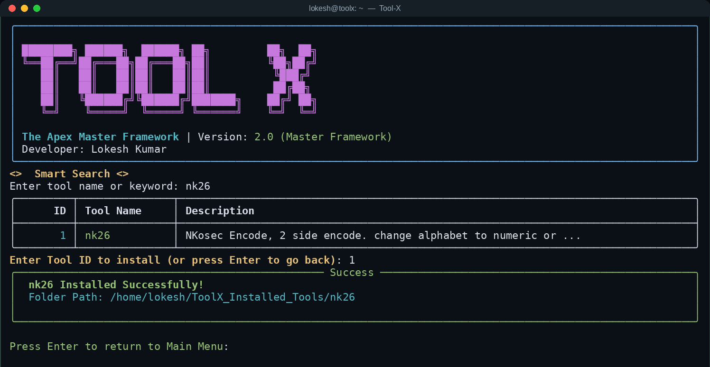
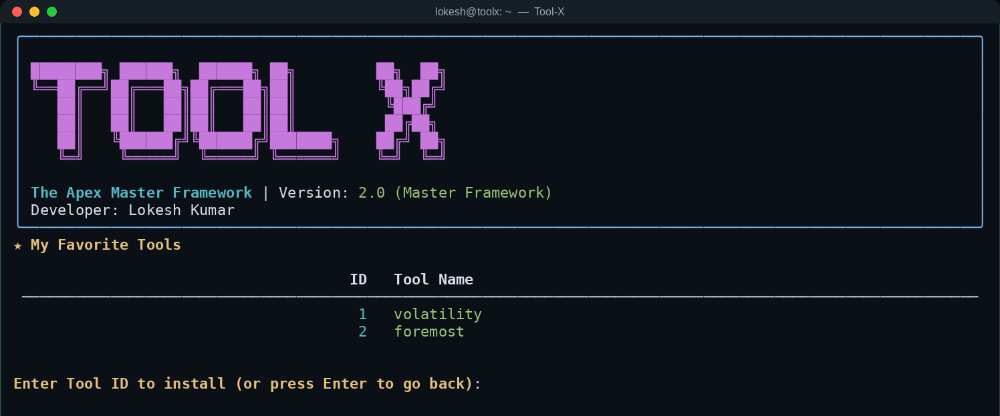
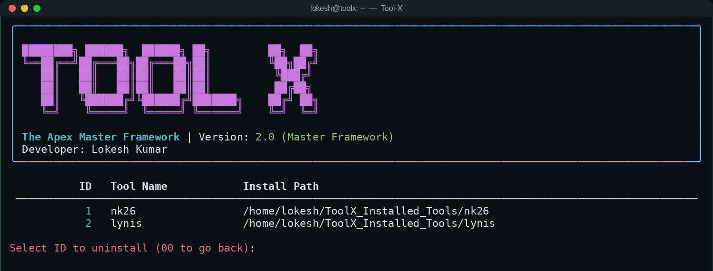

<div align="center">

# ` TOOL-X `

</div>

# The Apex Master Framework - Ultimate Multi-Platform Tool Installer (1000+ Tools)
---


[](https://www.youtube.com/watch?v=IJIoPsx3Yss)

---


- Tool-X is a high-end, professional, and automation-focused CLI framework designed to install and manage **1000+ hacking, OSINT, security, and research tools** directly from GitHub with a single interactive interface.

- **`This is not just a tool installer.`** - This is a full-scale terminal framework engineered for power users, ethical hackers, researchers, and advanced Termux/Linux users who want speed, automation, and scalability in their workflow.

- Instead of wasting hours manually cloning repositories, fixing dependencies, and configuring tools one-by-one, Tool-X centralizes the entire process into a single intelligent dashboard with Numeric ID based execution.

---


- Supports 1000+ tools in one framework  
- Universal OS Compatibility (Linux, Termux, Windows, macOS)
- Saves massive setup time  
- Fully automated GitHub tool deployment & Dependency handling
- Clean Rich UI based professional interface with Boot Animations
- Smart search + pagination system  
- Centralized tool management dashboard  

Tool-X acts like a **specialized package manager for hacking & security tools**.

---

## Video Tutorial (A to Z)

New to Tool-X? Watch the complete walkthrough: installing Tool-X, using the menu, search and favorites, then installing, running and uninstalling real tools, with a simple real-life example for every step.

[](https://www.youtube.com/watch?v=IJIoPsx3Yss)

**Watch on YouTube:** https://www.youtube.com/watch?v=IJIoPsx3Yss  
Narration is in Hindi (7 min 25 sec), on-screen captions are in Hinglish.

| Time | Topic |
|------|-------|
| [00:00](https://www.youtube.com/watch?v=IJIoPsx3Yss&t=0s) | Intro |
| [00:16](https://www.youtube.com/watch?v=IJIoPsx3Yss&t=16s) | What is Tool-X? |
| [00:53](https://www.youtube.com/watch?v=IJIoPsx3Yss&t=53s) | Requirements |
| [01:07](https://www.youtube.com/watch?v=IJIoPsx3Yss&t=67s) | Install in 4 easy steps |
| [01:53](https://www.youtube.com/watch?v=IJIoPsx3Yss&t=113s) | Main menu and categories |
| [02:37](https://www.youtube.com/watch?v=IJIoPsx3Yss&t=157s) | Show All and Smart Search |
| [03:06](https://www.youtube.com/watch?v=IJIoPsx3Yss&t=186s) | Favorites |
| [03:30](https://www.youtube.com/watch?v=IJIoPsx3Yss&t=210s) | Installing a tool (live demo) |
| [04:06](https://www.youtube.com/watch?v=IJIoPsx3Yss&t=246s) | Running tools: nk26 and Lynis |
| [05:19](https://www.youtube.com/watch?v=IJIoPsx3Yss&t=319s) | Uninstalling a tool |
| [05:49](https://www.youtube.com/watch?v=IJIoPsx3Yss&t=349s) | Updating Tool-X |
| [06:27](https://www.youtube.com/watch?v=IJIoPsx3Yss&t=387s) | Under the hood: `data.json` |
| [06:50](https://www.youtube.com/watch?v=IJIoPsx3Yss&t=410s) | Safety and legal note |

---

### Demo

https://github.com/user-attachments/assets/3dc3712b-ca85-4ce4-a2da-672ca36a8d91

---


- **1000+ Integrated Tools Database** - **Universal Multi-Platform Support** (Auto-detects pacman, apt, brew, pkg)
- **Smart Numeric ID System** (Install tools by typing numbers, no long names)
- **Epic System Boot Sequence & OS Scanning**
- Smart Search Engine (matches name and description, and suggests close matches when nothing matches)
- Favorites System (Persistent System Storage)  
- Category-Based Tool Organization & Pagination  
- Built-in Uninstall Manager  
- Built-in Self-Update (menu option `99`)
- Rich Console Professional UI  
- One Command Global Execution (`toolx`)  

This level of automation is rarely seen in CLI frameworks.


---


## Quick Start

**Requirements:** Python 3, Git and an internet connection. The setup script installs Git and Python for you when they are missing, and also installs the Python libraries `rich`, `requests` and `beautifulsoup4`.

### 1. Install (Termux, Kali, Ubuntu, Arch, Mac)

```bash
bash <(curl -s https://raw.githubusercontent.com/trmxvibs/Tool-X/main/setup.sh)
```

### 2. Run the framework

Any of these commands starts Tool-X:

```sh
toolx      # also: Toolx, Tool-x, tool-x
```

### What the setup command does

- Detects your environment, OS and package manager
- Installs required system dependencies (git, python) and Python libraries
- Clones Tool-X (or updates it with `git pull` if it is already there)
- Creates the global `toolx` command (plus the `Toolx`, `Tool-x` and `tool-x` variants)
- Prepares the full CLI dashboard

> Running the same setup command again is a safe way to update Tool-X.

---

## Screenshots

Real screens from Tool-X 2.0 (recorded on a Linux terminal).

**1. Boot sequence**



**2. Main menu: 19 categories plus utilities**



**3. Category view with pagination**



**4. Smart search and one-key install**



**5. Install finished: the tool path is shown**



**6. Favorites**



**7. Uninstall manager**



---

## How to Use

### Main menu

| Key | What it does |
|-----|--------------|
| `01` - `19` | Open a category and list its tools |
| `96` | Show all tools (paginated) |
| `97` | Smart search by name or keyword |
| `98` | Uninstall tools you installed with Tool-X |
| `99` | Update Tool-X |
| `F` | Open your favorites |
| `00` | Exit |

### Inside a tool list

| Input | What it does |
|-------|--------------|
| a tool ID (for example `1`) | Install that tool |
| `n` | Next page |
| `p` | Previous page |
| `b` (or `00`, `back`) | Go back |
| `fav <ID>` (for example `fav 4`) | Add that tool to your favorites |

### Example: install, run and remove a tool

1. Start Tool-X with `toolx`.
2. Press `97`, type `nk26`, then press `1` to install it. Tool-X clones it into `~/ToolX_Installed_Tools/nk26`.
3. Leave Tool-X (`00`) and run the tool the way its own README describes. For this one:

   ```bash
   cd ~/ToolX_Installed_Tools/nk26
   node nk26.js
   ```

   The demo prints the code `961515180115961136` for `hello there`, and decodes it back.
4. Start `toolx` again, press `98`, pick the tool ID and confirm with `y` to remove the tool folder.

> **Important:** Tool-X installs tools. How to run each tool is explained in that tool's own README, inside `~/ToolX_Installed_Tools/<tool-name>`. Some tools need extra dependencies of their own.

---

## Where Tool-X Keeps Its Files

| Path | Purpose |
|------|---------|
| `~/ToolX_Installed_Tools/` | Every tool you install is cloned here |
| `~/.tool-x/installed.json` | Record of installed tools and their paths |
| `~/.tool-x/favorites.json` | Your favorite tools |
| `~/.tool-x/error.log` | Error log for failed installs |
| `core/data.json` | The tool database (name, description, URL, category, dependencies) |

Want to add your own tool to the database? See the [Adding Tools Guide](ADDING_TOOLS.md).

---

## FAQ and Troubleshooting

**`toolx` says "command not found".**  
Open a new terminal window and try again. If it still fails, run the one-command installer again.

**How do I update Tool-X?**  
Press `99` in the main menu, or run the one-command installer again.

**An install failed. Where do I look?**  
Check `~/.tool-x/error.log`, then the tool's own repository for its requirements.

**Why does a category called "Uncategorized" exist?**  
Many tools in the database do not have a specific category yet. They are listed under it, and you can still search them with `97`.

**How do I remove everything?**  
Press `98` to uninstall tools from inside Tool-X. The tool folders live in `~/ToolX_Installed_Tools`.

---


| Platform | Support Level | Package Manager |
|----------|--------------|-----------------|
| Termux (Android) | Full Support | `pkg` |
| Kali / Parrot OS | Full Support | `apt` |
| Ubuntu / Debian | Full Support | `apt` |
| Arch / BlackArch | Full Support | `pacman` |
| macOS | Full Support | `brew` |
| Windows (GitBash) | Supported | Manual / Scripted |

---


Video → [A to Z Tutorial on YouTube](https://www.youtube.com/watch?v=IJIoPsx3Yss)

Developers → [Architecture Guide](ARCHITECTURE.md)

Contributors → [Adding Tools Guide](ADDING_TOOLS.md)

Community → [Contribution Guide](CONTRIBUTING.md)

Security → [Security Policy](SECURITY.md)

---

## Disclaimer

Tool-X is a tool **installer**. The tools it installs belong to their original authors and are provided for **educational purposes and authorized security testing only**. Testing any system without the owner's permission is illegal. You are fully responsible for how you use these tools.

---

## Author

**Lokesh Kumar** ([@trmxvibs](https://github.com/trmxvibs)). If Tool-X helps you, please give the repository a star.

---

## ⭐ Star History

<picture>
  <source media="(prefers-color-scheme: dark)" srcset="https://api.star-history.com/svg?repos=trmxvibs/Tool-X&type=Date&theme=dark" />
  <source media="(prefers-color-scheme: light)" srcset="https://api.star-history.com/svg?repos=trmxvibs/Tool-X&type=Date" />
  
</picture>
